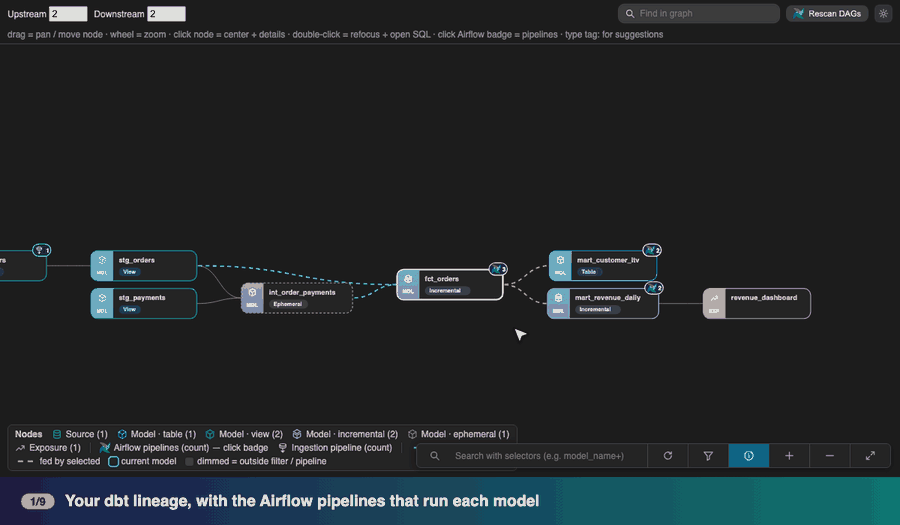
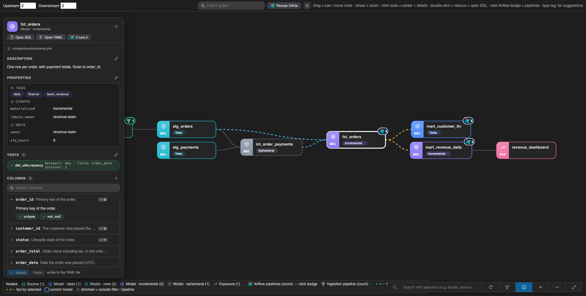
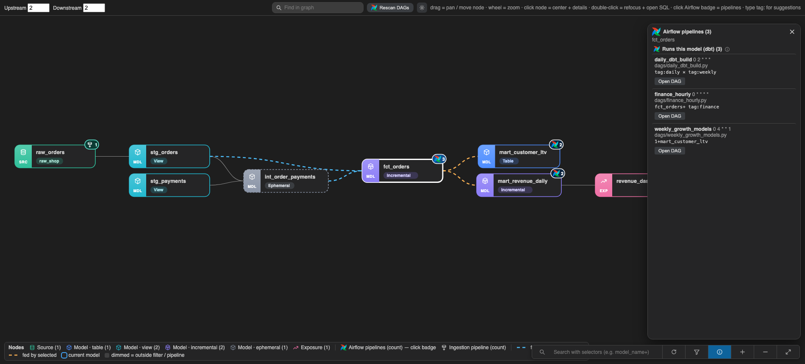
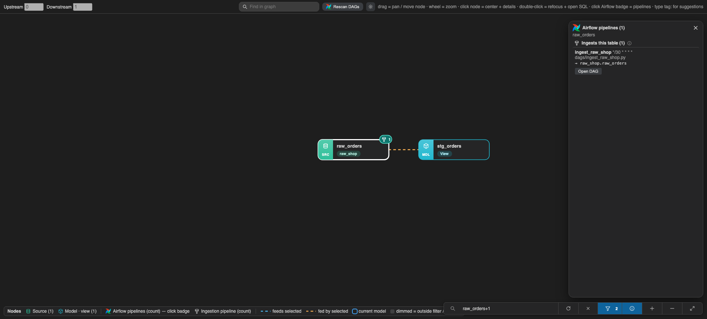
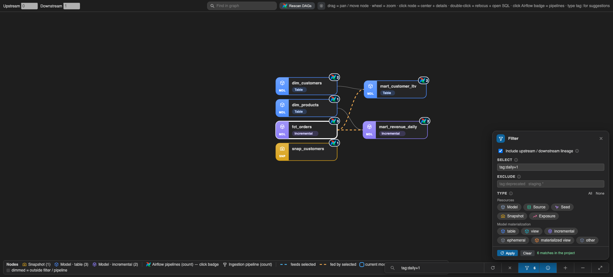

# dbt airflow lineage

A VS Code extension that draws your **dbt lineage** and shows, on every model, **which Airflow pipelines run it** and **which pipeline ingests it**. It understands dbt selectors (`tag:daily`, `model+`, `1+model+1`, `--exclude …`), so the pipelines you see are the ones whose selection really includes the model.



*A 30-second tour on a made-up shop project: click a model, see which Airflow pipelines run it, search with dbt selectors, filter, find the ingestion pipeline of a source, and edit the YAML in place.*

## What you get

- **Lineage graph** from your `target/manifest.json`: drag nodes, pan, zoom, and click a node to center it and animate its upstream (blue) and downstream (orange) links.
- **Which pipelines run a model.** The extension reads your Airflow DAG code, finds the dbt selections (`dbt_selector=`, `dbt_exclude=`, `"selector"`, `dbt run --select … --exclude …`) and resolves them with a built-in implementation of the dbt selector language. Click the Airflow badge on a node to see every pipeline, its schedule, and the exact selector that matched.
- **Which pipeline ingests a table.** DAGs that write to a BigQuery table (`bq_dataset` + `bq_table`, `target_table`, …) are matched to the dbt source or model by its real dataset and table name. They get a separate teal badge.
- **dbt selector search.** A floating search box takes real dbt syntax: `tag:finance,tag:daily`, `+orders`, `1+orders+1`, `orders+1`, `path:models/marts`. A `+` in the selector sets the upstream / downstream depth for you.
- **Filter** by select, exclude, resource type, and model materialization (table, view, incremental, ephemeral, materialized view). **Find in graph** dims everything but the nodes you type.
- **Edit the YAML without leaving the graph.** The model dialog shows description, tags, config, meta, tests, and columns from the model's properties file. Edit them and press **Submit**; only the lines you changed are written, so comments and formatting stay untouched.
- **Optional Airflow.** Lineage works on its own. Add a local DAG folder, or mirror DAGs from a Google Cloud Storage bucket, whenever you want pipelines.

|  |  |
|---|---|
|  |  |
|  |  |

*(Screenshots use a small made-up shop project.)*

## Requirements

- **VS Code 1.85 or newer** (also works in VS Code-compatible editors that can install a `.vsix`).
- A **dbt project** with a compiled manifest: run `dbt parse` (or any dbt command that writes `target/manifest.json`) at least once. The extension can run it for you (**dbt Airflow: Run dbt parse**).
- *Optional:* Airflow DAG code, either as a folder on your machine or in a Google Cloud Storage bucket. Reading a bucket needs the [Google Cloud CLI](https://cloud.google.com/sdk/docs/install) (`gcloud`) and access to it.

## Install

### Option 1 — VS Code Marketplace

Open the Extensions view (`Cmd/Ctrl+Shift+X`), search for **dbt airflow lineage**, and click **Install**.

> If you don't find it there yet, use Option 2.

### Option 2 — From a `.vsix` file (works today)

1. Download the latest `dbt-airflow-lineage-<version>.vsix` from the [Releases page](https://github.com/tchandrap/dbt-airflow-lineage/releases).
2. In VS Code open the Extensions view, click the **`…`** menu at the top right, choose **Install from VSIX…**, and pick the file.
   Or from a terminal:
   ```bash
   code --install-extension dbt-airflow-lineage-<version>.vsix
   ```
3. Reload the window (**Developer: Reload Window**).

> **Using several editors?** On macOS the `code` command can point at a different editor (for example Cursor). Use **Install from VSIX…** inside the editor you want, or call that editor's own binary, e.g.
> `"/Applications/Visual Studio Code.app/Contents/Resources/app/bin/code" --install-extension <file>.vsix`.

### Option 3 — Build from source

```bash
git clone https://github.com/tchandrap/dbt-airflow-lineage.git
cd dbt-airflow-lineage
npm ci
npm run build
npx vsce package          # creates dbt-airflow-lineage-<version>.vsix
code --install-extension dbt-airflow-lineage-*.vsix
```

## Quick start

1. Open your **dbt project folder** (the one with `dbt_project.yml`) in VS Code.
2. Make sure `target/manifest.json` exists (`dbt parse`).
3. Open any model `.sql` file. A CodeLens at the top says **Lineage**; click it, or run **dbt Airflow: Show Lineage for Current Model**. The graph opens as a tab in the bottom panel and then follows the model file you are editing.
4. Click a node for its details, double-click to refocus and open its SQL.
5. *Optional:* run **dbt Airflow: Set up Airflow pipelines…** (or press **Set up Airflow** at the top right of the graph) to connect your DAGs.

### Connecting Airflow (optional)

The setup wizard offers three choices:

| Choice | What it does |
|---|---|
| **Local folder** | Pick one or more folders that contain your DAG code (for example a checkout of your Airflow repo). Press **Rescan DAGs** after the code changes. |
| **Google Cloud Storage** | Checks that `gcloud` is installed and you are signed in, lets you **browse buckets and folders** (or type `gs://bucket/dags`), tests that you can read the path, and mirrors the DAG code into a private cache folder. Press **Sync DAGs** to refresh. If your login has expired it offers to run `gcloud auth login` in a terminal, or switch account, and then retries. |
| **Not now** | Lineage only. |

Nothing is downloaded until you choose Google Cloud Storage and confirm. Only `.py` files are copied (the extension only reads DAG source code), and `tests/` and `__pycache__/` folders are skipped, so test data in a bucket is never downloaded; change this with `dbtAirflow.dagsSyncExclude` (Python regexes, matched against the path inside the bucket folder; no commas). The copy lives in the extension's own storage by default (or a folder you choose, in an `airflow-dags-cache` sub-folder that is the only place the extension ever deletes from).

## Using the graph

| Do this | To get this |
|---|---|
| Click a node | Center it, animate its links, open its details |
| Double-click a node | Refocus the graph on it and open its SQL file |
| Click the Airflow badge | Pipelines that run the model, with schedule and the matching selector |
| Click the teal badge | Pipelines that ingest the table |
| Click a pipeline in that dialog | Highlight everything it touches in the graph |
| Type in the floating search | Show a dbt selection as its own graph (`tag:a,tag:b`, `model+1`, …) |
| Funnel button | Select / exclude / type filter |
| Search icon at the top right | Find a node by name or tag in the current graph |
| Pencil in the model dialog | Edit that section; **Submit** writes the YAML |

Selector syntax follows dbt: a space is a union, a comma is an intersection, `+model` adds parents, `model+` adds children, `N+` limits depth, `@model` adds everything related, and **Exclude** removes nodes from the selection. While you type `tag:` the extension suggests your project's tags.

## Settings

Search for "dbt Airflow" in Settings, or edit `settings.json`:

| Setting | Default | Meaning |
|---|---|---|
| `dbtAirflow.projectDir` | auto-detect | Folder with `dbt_project.yml`. |
| `dbtAirflow.manifestPath` | `target/manifest.json` | Manifest path relative to the project. |
| `dbtAirflow.airflowSource` | `auto` | `none`, `local`, `gcs`, or `auto` (local if `airflowPaths` is set). |
| `dbtAirflow.airflowPaths` | `[]` | DAG folders for the local source. |
| `dbtAirflow.dagsBucket` | empty | `gs://bucket/folder` for the GCS source. |
| `dbtAirflow.dagsDownloadDir` | extension storage | Where to keep the downloaded DAGs. |
| `dbtAirflow.dagsSyncExclude` | only `.py`, no `tests/` | Regexes for bucket objects *not* to download (see below). |
| `dbtAirflow.upstreamDepth` / `downstreamDepth` | `2` / `2` | Levels shown around the focused model. |
| `dbtAirflow.dbtCommand` | `dbt` | Command used by **Run dbt parse**. |

## Commands

- **dbt Airflow: Show Lineage for Current Model**
- **dbt Airflow: Set up Airflow pipelines…**
- **dbt Airflow: Sync Airflow DAGs from GCS**
- **dbt Airflow: Run dbt parse**
- **dbt Airflow: Refresh (re-read manifest and DAGs)**

## How it works

- **Lineage** comes from the `parent_map` in `target/manifest.json`. A background process slims even very large manifests (hundreds of MB) into a small cached graph, so opening and navigating is fast. It refreshes when the manifest changes.
- **Selectors** are resolved by a TypeScript implementation of the dbt selection language, run against that graph.
- **Airflow** is read as source text with a small tokenizer: no Airflow install and no DAG imports. Selectors built at runtime (f-strings, values read from config) are shown as *dynamic* and are not resolved.
- **YAML edits** use a parser that reports source positions, then splice only the changed lines into the file.
- No data leaves your machine, except the optional `gcloud` calls you trigger yourself, which use your own credentials. There is no telemetry.

## Limitations

- Lineage is only as fresh as your last `dbt parse`.
- Model-level lineage only; there is no column-level lineage.
- Selector methods that need run state (`state:`, `result:`, `test_name:`, `version:`) are not supported and show a warning.
- Ingestion is found from explicit write keys in DAG code (`bq_dataset` + `bq_table`, `target_table`, `destination_table`, …). Tables loaded by other systems (Kafka connectors, Dataflow, Terraform, …) are not detected.
- A model that inherits its tests or columns through YAML merge keys (`<<: *anchor`) is readable, but adding tests to inherited entries is refused so the inherited ones are not silently overridden.
- The selector engine is a re-implementation, not dbt's own code. If a result surprises you, compare with `dbt ls --select …`.

## Troubleshooting

| Problem | Try |
|---|---|
| "manifest.json not found" | Run `dbt parse` in the dbt project, or set `dbtAirflow.projectDir` / `manifestPath`. |
| Nothing happens after installing | Reload the window; open the dbt project folder (the one containing `dbt_project.yml`). |
| No pipelines shown | Run **Set up Airflow pipelines…**; check the DAG folder really contains the DAG `.py` files. |
| "Reauthentication failed" when syncing | Choose **Sign in with gcloud** in the dialog, or run `gcloud auth login` yourself. |
| "gcloud crashed (TypeError …)" when syncing | That is a bug inside `gcloud` that hides the real error. The extension retries with `gsutil`; also try `gcloud components update`, and point the path at the DAGs folder rather than the bucket root. |
| A model shows no YAML | It is not declared in any properties `.yml`, or it belongs to an installed package. |
| Details of the last operation | **View → Output → dbt airflow lineage**. |

## Development

```bash
npm ci
npm run build      # bundle extension + webview into dist/
npm test           # unit tests (selector engine, DAG parser, YAML editor, payloads, gcloud helpers)
npm run watch
```

Press **F5** in VS Code to launch an Extension Development Host. The code is organized as:

| Path | Purpose |
|---|---|
| `src/extension.ts` | Activation, views, commands, Airflow setup wizard |
| `src/selector.ts` | dbt selector engine |
| `src/airflow.ts` | DAG tokenizer and selector / ingestion detection |
| `src/index.ts`, `src/payload.ts` | Joins graph and pipelines; builds the view model |
| `src/meta.ts` | Surgical YAML reader / editor |
| `src/gcloud.ts` | `gcloud` helpers and error classification |
| `src/slimWorker.ts` | Manifest → slim graph (runs in a child process) |
| `src/webview/` | The graph UI |

Releases: tag a commit `vX.Y.Z` and push the tag; the **Release** workflow builds the `.vsix`, attaches it to a GitHub release, and publishes to the Marketplace / Open VSX when the `VSCE_PAT` / `OVSX_PAT` repository secrets exist.

Issues and pull requests are welcome.

## License and notices

[MIT](LICENSE). This project is not affiliated with or endorsed by dbt Labs or the Apache Software Foundation. "dbt" and the dbt logo are trademarks of dbt Labs, Inc.; "Apache Airflow" and its logo are trademarks of the Apache Software Foundation. The two logos appear only to show which tools the extension works with: in the extension icon and on pipeline badges. The Airflow logo comes from the [dashboard-icons](https://github.com/homarr-labs/dashboard-icons) collection (Apache-2.0) and the dbt mark from [Simple Icons](https://simpleicons.org) (CC0); the marks themselves remain their owners' property.
